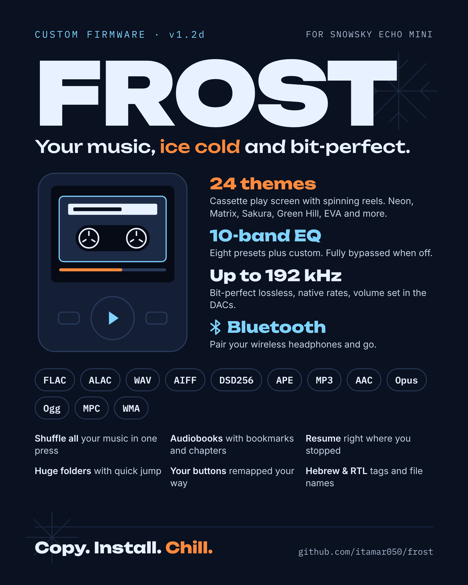

# FROST

**Custom firmware for the SNOWSKY Echo Mini (8 GB).** Version 1.2c.

<p align="center"></p>

FROST is a fork of [echo-mini-newfw](https://github.com/berettavexee/echo-mini-newfw) 0.95 by
berettavexee, a from-scratch firmware for the Rockchip RKNanoD inside the player. It keeps all
of newfw (its decoders, gapless playback, ReplayGain, resume, USB disk and installer) and adds
a new interface, more formats and an equalizer.

> **Beta.** Keep a stock firmware image and know the recovery procedure before installing
> (see [Installing](FROST.md#installing)).

## Highlights

- **Bit-perfect lossless** playback at native sample rates up to 192 kHz; the volume is set in
  the two CS43131 DACs, not in the samples.
- **Formats:** FLAC, WAV, AIFF, ALAC, APE, DSF/DFF up to DSD256 (played as 88.2 kHz/24-bit),
  MP3, AAC/M4A, Ogg Vorbis, Opus, Musepack, WMA 1/2.
- **10-band equalizer** (31 Hz to 16 kHz, ±12 dB) with presets: Flat, Rock, Pop, Jazz,
  Classical, Bass boost, Vocal, Treble and Custom. Fully bypassed when off.
- **24 themes** and a cassette-style play screen with spinning reels.
- **Shuffle all music**, plus play modes: in order, repeat all, repeat one, shuffle, folders.
- **Audiobooks:** bookmarks, m4b chapters, 30-second skips. Sleep timer.
- **Big libraries:** unlimited files, large folders, fast scrolling and quick jump.
- **Hebrew and right-to-left text** in names and tags (ID3, Vorbis, APE, MP4, ASF).
- **Button remapping** on the player or with `KEYMAP.TXT`.
- 3.5 mm and 4.4 mm balanced outputs, microSD (FAT32/exFAT), USB disk mode.

Bluetooth is turned off in this release while it is being worked on.

## Quick install

1. Copy `HIFIEC70.IMG` to the top folder of the player's disk over USB, then eject.
2. On the player, hold **MENU** and choose **Install a firmware (.IMG)**.
3. Wait for it to finish and restart.

The full illustrated guide: [INSTALL.md](INSTALL.md), printable as [install-guide.pdf](docs/promo/install-guide.pdf)
([PNG](docs/promo/install-guide.png)). Recovery and the loader route are in
[FROST.md](FROST.md#installing).

## Documentation

| File | What's in it |
|---|---|
| [FROST.md](FROST.md) | Everything FROST adds, button mapping, installing, building, licences |
| [MANUAL.md](MANUAL.md) | The keys on each screen (from newfw) |
| [fw/README.md](fw/README.md) | Building the image and the emulator |
| [README.newfw.md](README.newfw.md) | The original newfw README: formats, core B load, design |
| [docs/promo](docs/promo) | Flyer and install guide (PNG and PDF) |

## Building

```sh
make -C fw          # build the image
make -C fw check    # lint, host tests and a strict build
```

See [fw/README.md](fw/README.md) for the toolchain.

## Licences

newfw's own code has no licence stated in its repository, and all rights stay with its author.
This repository is private for that reason. Ask the newfw author before redistributing it or
images built from it. libdemac and libwma (from Rockbox) are GPL v2 or later; the other
third-party parts keep their own licences. Details: [FROST.md](FROST.md#licences).

FROST is community firmware and is not made by or affiliated with SNOWSKY.
